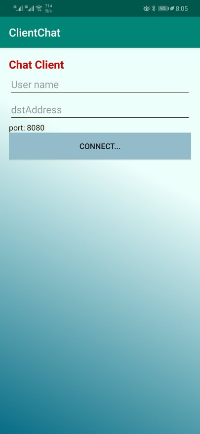
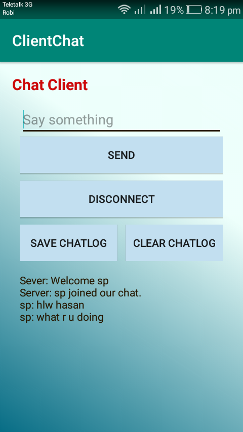
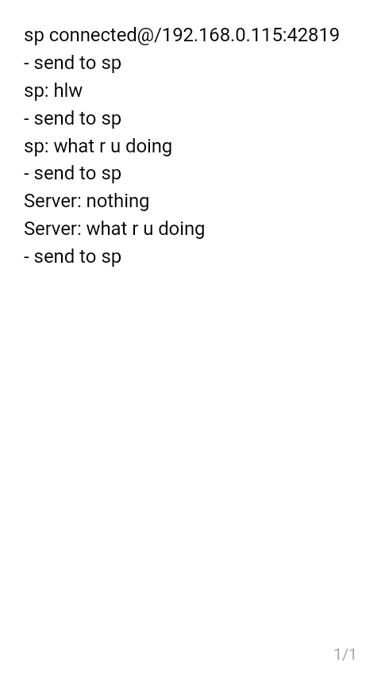

# LAN Chat for Android (Server and Client Apps)

Two native Android apps written in Java that let several phones on the same Wi-Fi network chat through a central server app over TCP sockets. Built as a university networking project.

Despite the repository name, the design is **client–server**: one phone runs the server app and every other phone connects to it.

## Features

**Server app**

- Accepts multiple clients on port 8080 and relays messages
- Broadcast to all users, or message one selected client
- Drop-down list of connected clients
- Save the chat log to a `.txt` file in external storage, and clear it

**Client app**

- Login screen for display name and server IP address
- Scrolling conversation view with send button
- Disconnect button that notifies the other participants
- Save and clear the local chat log
- Splash screen and gradient UI

| Client login | Client chat | Server chat log |
|:---:|:---:|:---:|
|  |  |  |

More screenshots are in [`Screenshot/`](Screenshot).

## Tech stack

Java · Android SDK (compile/target SDK 29, minimum SDK 15) · AndroidX AppCompat · `java.net` sockets · Gradle

## Project structure

```text
├── Server/        # Android Studio project for the server app
├── Client/        # Android Studio project for the client app
├── projectApk/    # Prebuilt debug APKs (serverapp-debug.apk, clientapp-debug.apk)
└── Screenshot/
```

## Running

**From the prebuilt APKs:** install `projectApk/serverapp-debug.apk` on one device and `clientapp-debug.apk` on the others. They are unsigned debug builds, so Android will warn that they come from an unknown source. Start the server, note its IP address, then enter that address in each client.

**From source:** open `Server/` or `Client/` in Android Studio and run on a device or emulator. All devices must be on the same network.

## Limitations

- Messages are sent in plain text with no authentication.
- Builds use an older Gradle/Android Gradle Plugin setup and may need upgrading for current Android Studio.
- No automated tests.

## Author

**S M Mahamudul Hasan** · [GitHub](https://github.com/hasansust32)
